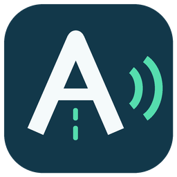

# ADrive Voice

Бесплатная утилита для локальной озвучки вопросов и вариантов ответов в ADrive голосом «Ксения». Для Windows x64. Это независимое приложение, не официальный продукт ADrive.

## Скачать

**[Скачать ADrive Voice для Windows — ZIP, 406 МБ](https://github.com/vladrufi57-prog/adrive-voice/releases/download/v0.1.0/ADrive-Voice-Windows-x64.zip)**

[Описание версии и контрольная сумма](https://github.com/vladrufi57-prog/adrive-voice/releases/tag/v0.1.0)

1. Скачайте ZIP по ссылке выше и распакуйте **всю папку**.
2. Запустите `ADrive Voice.exe`.
3. Откройте установленный ADrive и вопрос с полностью видимым текстом. Дождитесь прогрева голоса.

При включённом «Авто» новые вопросы читаются автоматически. Python, отдельный OCR и интернет для работы не требуются. Сам ADrive в комплект не входит.

Этот репозиторий — страница распространения готового приложения. Кнопка GitHub **Code → Download ZIP** скачивает только эту страницу; приложение находится в **Releases** по ссылке выше.

## Управление

| Кнопка / клавиша | Действие |
|---|---|
| Пауза / Продолжить · Пробел | Пауза и продолжение с того же места |
| Повтор · R / К | Читать вопрос и ответы сначала |
| Стоп | Прекратить текущий вопрос |
| Авто | Читать новый вопрос после переключения; зелёный означает «включено» |
| Ползунок скорости | От 0,75× до 1,50×; применяется со следующего вопроса или повтора |
| Настройки | Аудиовыход, справка, восстановление и выход |

Клавиши действуют только в ADrive и панели утилиты. Ответы выбирает пользователь. Скрытые или обрезанные слова приложение не угадывает.

## Размер и хранение

ZIP занимает около 406 МБ, распакованная папка — 962 МБ. Внутри находятся локальный голос, PyTorch, Python, OCR и библиотеки интерфейса. Папку `_internal` удалять нельзя; переносить приложение нужно целиком.

Настройки и диагностический журнал создаются локально в `%LOCALAPPDATA%\ADriveVoice`. Личные настройки автора, журналы и снимки билетов в скачивание не включены.

## Статус версии 0.1.0

**Предварительная версия.** Проверена на Windows 10 x64. Пройдены 88 тестов исходников, запуск автономного EXE, синтез голоса, OCR контрольной строки, аудиоустройство, интерфейс и целостность ZIP. Исправлена загрузка модели из пути с кириллицей.

Не завершены: чтение реального билета именно этой сборкой, 30 переходов, 20 минут устойчивой работы и проверка на независимом ПК. Работа на всех компьютерах не гарантируется.

## Условия использования

Скачивание бесплатное. Комплект с голосом Silero предназначен для **некоммерческого использования**. Поставленная неизменённая модель Silero v5_ru распространяется по CC BY-NC-SA 4.0; её текст лицензии и уведомления других компонентов находятся в папке «Лицензии» внутри ZIP. Это не разрешение на коммерческое использование голоса.

Авторы голоса: [Silero Team](https://github.com/snakers4/silero-models). Интерфейс использует Qt/PySide6, OCR — Tesseract. Компоненты сохраняют свои лицензии. База вопросов, лицензия и установочные файлы ADrive не распространяются.
